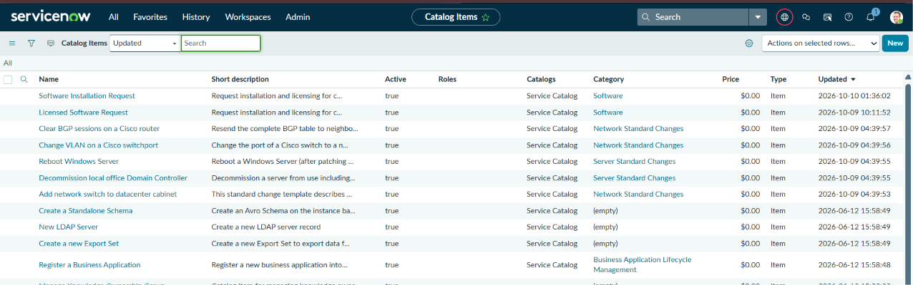
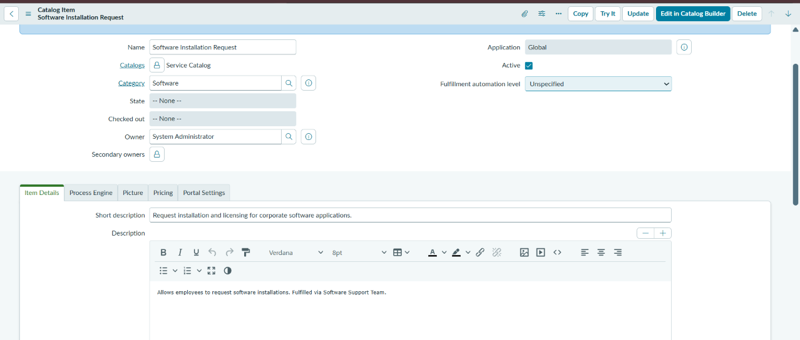
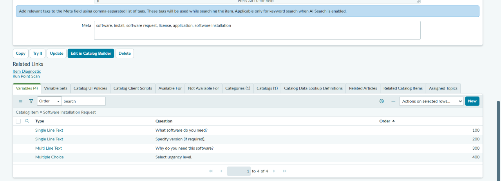
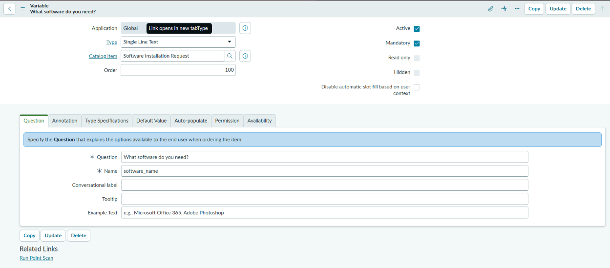
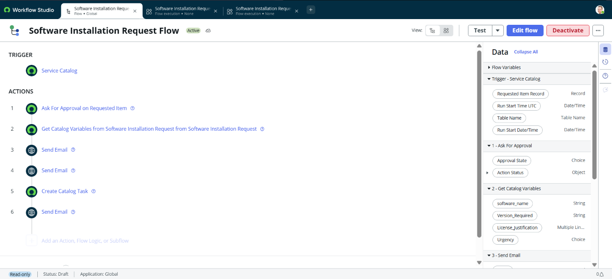
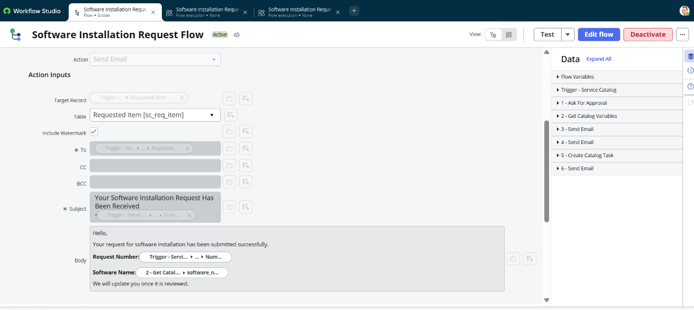
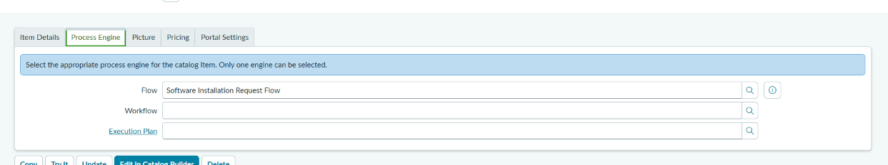
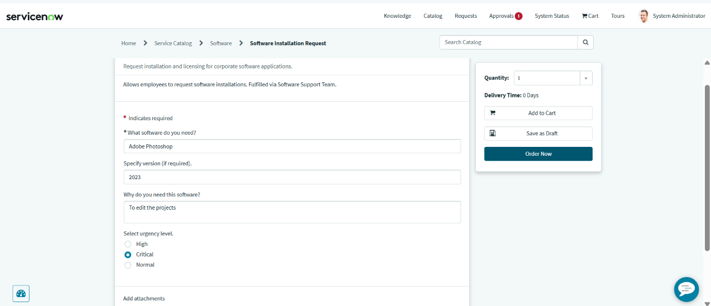
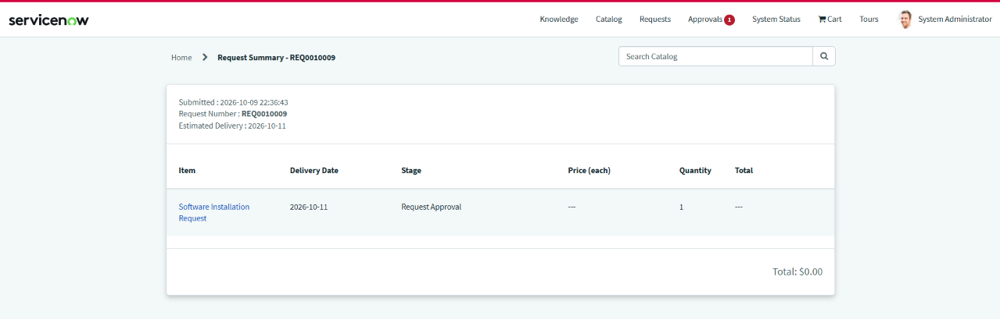
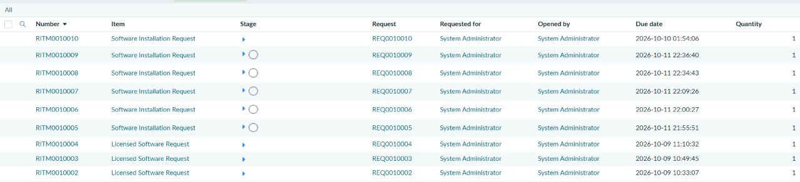

# Setup & Recreation Manual: Software Installation Request

This document provides a step-by-step manual for recreating the **Software Installation Request** catalog item, variables, Flow Designer workflow, process engine binding, and test submission in a ServiceNow Personal Developer Instance (PDI).

---

## Step 1: Catalog Item Table Verification
Navigate to **Service Catalog > Catalog Definitions > Maintain Items** (`sc_cat_item.list`) to view the list of existing catalog items before creating a new definition.

1. Open the filter navigator and type `sc_cat_item.list`.
2. Verify that the catalog item list loads properly.

---

## Step 2: Catalog Item Creation & Details
Create and configure the main Catalog Item definition:

1. Click **New** at the top of the Catalog Items list.
2. Fill out the following fields:
   - **Name:** Software Installation Request
   - **Catalogs:** Service Catalog
   - **Category:** Software
   - **Short Description:** Request installation and licensing for corporate software applications.
   - **Description:** Allows employees to request software installations. Fulfilled via Software Support Team.
3. Click **Submit** or **Save**.

---

## Step 3: Variable List Configuration
Scroll down to the **Variables** related list at the bottom of your newly created Catalog Item form to define user inputs:

1. Locate the **Variables** tab in the related lists.
2. Click **New** to create each required input variable.

---

## Step 4: Variable Setup Details
Configure individual variable properties (e.g., `software_name`):

1. **Type:** Single Line Text
2. **Question:** What software do you need?
3. **Name:** software_name
4. **Mandatory:** Checked (`true`)
5. Save the variable and repeat for remaining fields (`software_version`, `business_justification`, and `urgency_level`).

---

### 5. User & Manager Profile Setup (Prerequisite for Approval Routing)
To ensure dynamic approval routing and email recipient evaluation function without `Email has no recipients` errors:
1. Navigate to **`sys_user.list`**.
2. Locate and open the submitting user record (e.g., **`System Administrator`**).
3. Populate the **Manager** field with a valid manager record (e.g., **`Abel Tuter`**).
4. Open **Abel Tuter's** user record and ensure the **Email** field is populated with a valid email address (e.g., `abel.tuter@example.com`).
5. Click **Update** to save the user configuration.

---

### 6. Build Flow Designer Canvas Workflow
Navigate to **Process Automation > Flow Designer**, create a new flow named **`Software Installation Request Flow`**, and set the trigger to **`Service Catalog`**. 

Configure the exact 5-step automated sequence:
1. **Step 1 (Ask for Approval):** Triggers a dynamic approval request routed to `Trigger -> Requested Item Record -> Requested for -> Manager` (**Abel Tuter**).
2. **Step 2 (Send Email - Approval Requested):** Automatically dispatches an email notification (**`Approval Needed: Software Installation Request - [RITM Number]`**) to the manager (**Abel Tuter**).
3. **Step 3 (Send Email - Request Received Confirmation):** Sends an email notification (**`Your Software Installation Request Has Been Received - [RITM Number]`**) to the requester (**Abel Tuter** / Submitting user).
4. **Step 4 (Create Catalog Task):** Upon manager approval, automatically creates a fulfillment catalog task (`SCTASK`) and assigns it to the **Software** assignment group.
5. **Step 5 (Send Email - Task Assignment Notification):** Sends an email notification (**`Catalog Task SCTASK0010012 has been assigned to group Software`**) to the assignment group email (**`fred.luddy@example.com`**).

---

## Step 7: Linking Flow to Catalog Item
Link the published flow to the Catalog Item definition in ServiceNow backend:

1. Navigate back to **Service Catalog > Catalog Definitions > Maintain Items**.
2. Open **Software Installation Request**.
3. Click the **Process Engine** tab.
4. In the **Flow** field, search and select **Software Installation Request Flow**.
5. Click **Update**.

---

## Step 8: End-User Request via Service Portal
Perform end-to-end user acceptance testing from the Service Portal:

1. Go to your portal URL: `https://<instance>.service-now.com/sp`.
2. Search for and open **Software Installation Request**.
3. Fill out the request form:
   - **What software do you need?** Adobe Photoshop
   - **Specify version:** 2023
   - **Why do you need this software?** To edit the projects
   - **Select urgency level:** Critical

---

## Step 9: Order Confirmation Screen
Submit the order and confirm the generated Request Number:

1. Click **Order Now**.
2. Capture the submission confirmation screen displaying the generated **Request Number (REQ)**.

---

### 10. Verify Approvals, Tasks, and Outbound Email Logs
Validate the end-to-end execution of the flow:
1. **Approvals Verification:** Open **`sys_approval.list`**, locate the generated approval for **Abel Tuter**, right-click the state, and click **Approve**.
2. **Catalog Task Verification:** Open **`sc_task.list`** and verify that task **`SCTASK0010012`** was created and assigned to group **Software**.
3. **Email Logs Verification:** Navigate to **`sys_email.list`** and sort by **Created** (newest first) to verify all 3 requested email notifications generated successfully:
   - **Email 1 (Approval Needed):** Sent to `abel.tuter@example.com` with subject `Approval Needed: Software Installation Request - RITM0010013`.
   - **Email 2 (Request Received):** Sent to `abel.tuter@example.com` with subject `Your Software Installation Request Has Been Received - RITM0010013`.
   - **Email 3 (Group Task Assignment):** Sent to `fred.luddy@example.com` with subject `Catalog Task SCTASK0010012 has been assigned to group Software`.

